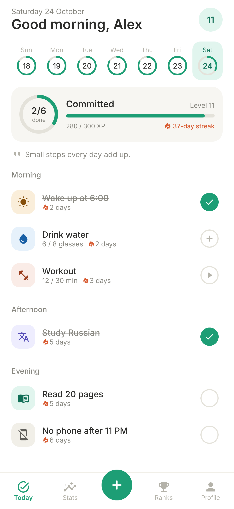
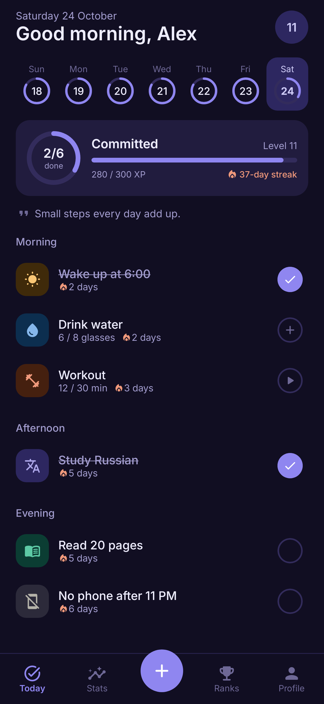
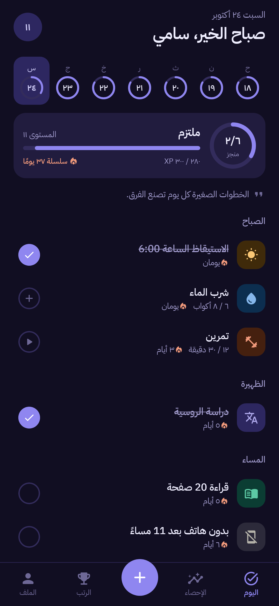
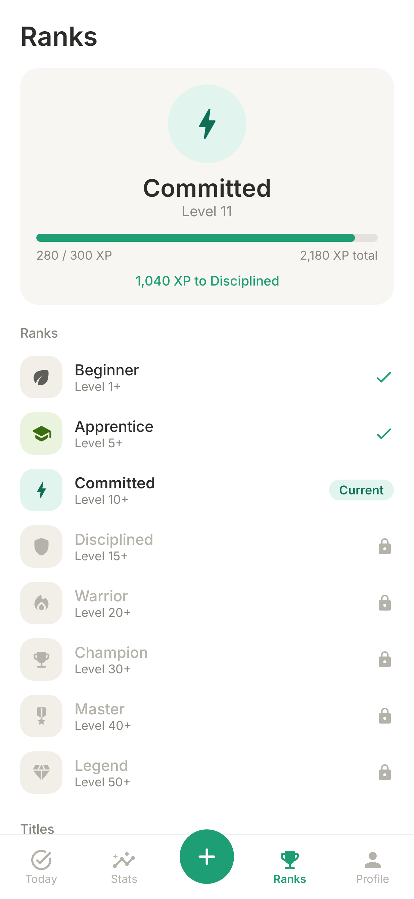

# Happit

A habit and daily-routine tracker for Android that keeps you going with XP, levels, ranks and titles. Works fully offline, in English and Arabic, with a light theme and a purple dark theme.

<p>
  
  
  
  
</p>

## Install

1. Open the [latest release](https://github.com/samirwattar/happit/releases/latest) on your phone and download `Happit-vX.Y.Z.apk`.
2. Open the file. If Android asks, allow your browser or file manager to install unknown apps.
3. Later updates: **Profile → Updates → Check for updates**. The app also checks on its own about twice a day and offers new versions.

## Features

- **Your own routine.** Add habits with an icon and color, pick the days (every day or specific weekdays) and the time of day (morning, afternoon, evening, anytime). Quick-start templates included.
- **Three habit types.** Check (done / not done), count (8 glasses of water) and duration (30 min of reading, with a built-in timer).
- **Today view.** Habits grouped by time of day, a progress ring, a 7-day strip to fix past days, and a daily line of encouragement.
- **XP and levels.** +10 XP per habit, streak bonuses (+5 at 7 days, +10 at 30) and +50 for a perfect day. Missing a day never costs XP.
- **8 ranks.** Beginner, Apprentice, Committed, Disciplined, Warrior, Champion, Master, Legend.
- **14 titles.** Unlocked through achievements (Early bird, Iron will, Comeback, ...). Show one on your profile.
- **Streak freezes.** Earned every 7-day streak and every new rank; they protect your streaks on a day you miss.
- **Celebrations.** Level-ups, rank-ups, perfect days and new titles get a confetti moment.
- **Stats.** Current and best streak, perfect days, last 7 days, a 4-month activity heatmap and per-habit 30-day rates.
- **Reminders.** Per-habit notifications with a "Done" button right in the notification.
- **Backup.** Export everything to a JSON file and import it on a new phone.
- **Languages and themes.** English and Arabic (full right-to-left layout), switchable in the app. System, light or dark theme.

## Build

Requirements: JDK 17+ and the Android SDK (platform 35).

```bash
./gradlew :app:testDebugUnitTest   # logic tests + UI tests that render screenshots to app/build/screens
./gradlew :app:assembleDebug       # debug APK, installs next to the release app
```

## Release an update

Releases are signed with the key in `keystore/` (described by `keystore.properties`). Neither is committed. **Back both up somewhere safe**: phones only accept updates signed with the same key, so losing it means everyone has to uninstall and reinstall.

```powershell
./release.ps1 -Version 1.1.0 -Notes "What changed"
```

The script bumps the version, runs the tests, builds the signed APK, tags the commit and creates a GitHub release with the APK attached. Installed apps pick it up from there.

## Project layout

```
app/src/main/java/io/github/samirwattar/happit/
  data/       Room database, settings, repository, JSON backup
  logic/      XP, levels, ranks, streaks, freezes, achievements (pure Kotlin, unit tested)
  reminders/  Alarm scheduling, notifications, boot handling
  update/     GitHub release check, download and install
  ui/         Jetpack Compose screens and theme
```

Fonts: [Inter](https://github.com/rsms/inter) and [IBM Plex Sans Arabic](https://github.com/IBM/plex), both under the SIL Open Font License (see `docs/fonts/`).
